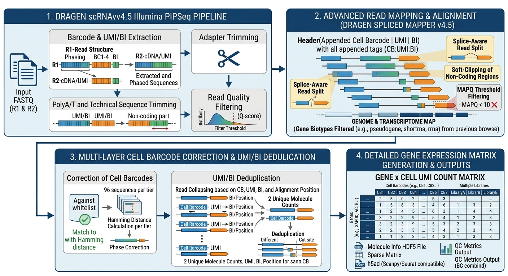
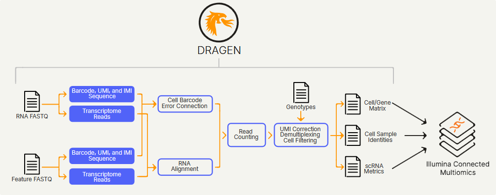

- [PIP-seq, Nice explanation on the library structure](https://teichlab.github.io/scg_lib_structs/methods_html/PIP-seq.html)
- [Illumina PIPseq scRNA](https://help.connected.illumina.com/dragen/dragen-v4.5/product-guides/dragen-v4.5/dragen-single-cell-pipeline/dragen-scrna-illumina#outputs)

##

##

## Single-Cell RNA Report

### Single-Cell RNA
### Trimer
### DRAGEN-FastQC
### Mapping