::: {.callout-note}
All numeric example outputs and schematic plots in this tutorial are synthetic teaching examples, not benchmark results. The R and Python scripts are provided for execution in your own environment. They are not executed during rendering, so the document can be rendered without installing the analysis packages. The actual labels depend on the reference/model version.
:::

# Introduction

Cell type annotation assigns biological identities to observations in a single-cell expression matrix. Clustering finds transcriptionally similar cells; annotation identifies what those cells are. Cell identity (e.g. CD8 T cell) should be distinguished from cell state (e.g. activated, proliferating or exhausted).

```{mermaid}
flowchart TD
 A[QC-filtered gene expression] --> B[Marker knowledge: ScType]
 A --> C[Reference similarity: SingleR]
 A --> D[Linear classifier: CellTypist]
 A --> E[Reference mapping: classical Azimuth]
 A --> F[Neural classifier: Pan-human Azimuth]
 A --> G[Semi-supervised latent model: scANVI]
 B & C & D & E & F & G --> H[Cell labels and confidence diagnostics]
 H --> I[Biological validation]
```

## Common teaching dataset

Use [10x PBMC 3K](https://satijalab.org/seurat/articles/pbmc3k_tutorial). The following small **normalized expression matrix** illustrates the signal used to distinguish T cells, B cells and monocytes. Real data contain thousands of genes and cells, and may be sparse.

| Gene | C1 | C2 | C3 | C4 | C5 | C6 |
|---|---:|---:|---:|---:|---:|---:|
| CD3D | 8 | 9 | 0 | 0 | 1 | 0 |
| CD3E | 9 | 7 | 1 | 0 | 0 | 0 |
| MS4A1 | 0 | 0 | 9 | 8 | 0 | 0 |
| CD79A | 1 | 0 | 8 | 9 | 0 | 0 |
| LYZ | 0 | 1 | 0 | 1 | 9 | 8 |
| S100A8 | 0 | 0 | 0 | 0 | 8 | 9 |

<figure style="margin: 1.2em auto; text-align:center">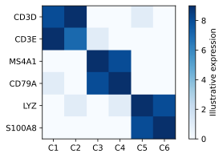<figcaption>Synthetic expression heatmap — synthetic illustration.</figcaption></figure>

## Prepare a Seurat object

```r
library(Seurat)
library(Matrix)
library(ggplot2)
counts <- Read10X('filtered_gene_bc_matrices/hg19/')
pbmc <- CreateSeuratObject(counts, min.cells=3, min.features=200)
pbmc[['percent.mt']] <- PercentageFeatureSet(pbmc, pattern='^MT-')
pbmc <- subset(pbmc, subset=nFeature_RNA > 200 &
                 nFeature_RNA < 2500 & percent.mt < 5)
pbmc <- NormalizeData(pbmc)
pbmc <- FindVariableFeatures(pbmc)
pbmc <- ScaleData(pbmc)
pbmc <- RunPCA(pbmc)
pbmc <- FindNeighbors(pbmc, dims=1:20)
pbmc <- FindClusters(pbmc, resolution=0.5)
pbmc <- RunUMAP(pbmc, dims=1:20)
DimPlot(pbmc, label=TRUE)
expr <- LayerData(pbmc, assay='RNA', layer='data')
raw <- LayerData(pbmc, assay='RNA', layer='counts')
```

QC thresholds are illustrative. For multi-library data, perform doublet detection per library, preserve sample IDs, and join split RNA layers when needed (`JoinLayers`). Clustering and UMAP are not prerequisites for most cell-level classifiers.

<figure style="margin: 1.2em auto; text-align:center">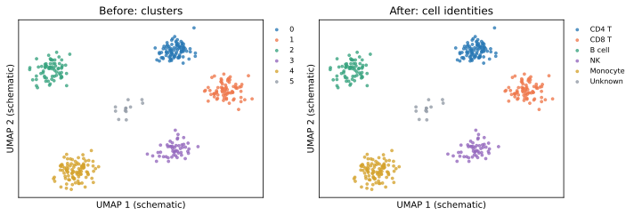<figcaption>Before and after annotation — synthetic illustration.</figcaption></figure>

# ScType: marker-based scoring

[Source and documentation](https://github.com/IanevskiAleksandr/sc-type) | [Publication](https://www.nature.com/articles/s41467-022-28803-w)

## Input

| Input object | Format | Example |
|---|---|---|
| Query | Genes × cells, log-normalized RNA or scaled expression | `expr` |
| Marker database | Cell type, positive and negative marker sets | Immune system |
| Cluster assignments | One cluster per cell | `pbmc$seurat_clusters` |

| Cell type | Positive markers | Negative markers |
|---|---|---|
| T cell | CD3D, CD3E, TRAC | MS4A1, CD79A |
| B cell | MS4A1, CD79A, CD19 | CD3D, CD3E |
| NK | NKG7, GNLY, KLRD1 | CD3D, CD3E |
| Monocyte | LYZ, S100A8, LST1 | CD3D, MS4A1 |

## Principle and steps

```{mermaid}
flowchart LR
 A[Expression] --> B[Gene-wise Z-score]
 M[Positive and negative markers] --> C[Weighted marker scoring]
 B --> C --> D[Sum scores by cluster] --> E[Best label or Unknown]
```

Standardize each gene across cells: $Z_{gc}=(X_{gc}-\mu_g)/\sigma_g$. ScType gives greater weight to specific markers and subtracts negative marker evidence. A simplified score is

$$S_{tc}=\frac{\sum_{g\in P_t}w_gZ_{gc}}{\sqrt{|P_t|}}-\frac{\sum_{g\in N_t}w_gZ_{gc}}{\sqrt{|N_t|}}.$$

For CD3D=2.5, CD3E=2, MS4A1=-1, CD79A=-0.5, equal weights give T score 4.24 and B score -4.24. Scores are summed across cells in each cluster; low-scoring clusters may be designated Unknown. This is a simplified calculation, not the full implementation.

<figure style="margin: 1.2em auto; text-align:center">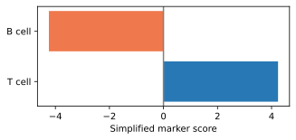<figcaption>Illustrative scores — synthetic illustration.</figcaption></figure>

## R script

```r
library(openxlsx)
library(dplyr)
base <- 'https://raw.githubusercontent.com/IanevskiAleksandr/sc-type/master/'
source(paste0(base,'R/gene_sets_prepare.R'))
source(paste0(base,'R/sctype_score_.R'))
gs <- gene_sets_prepare(paste0(base,'ScTypeDB_full.xlsx'), 'Immune system')
# Restrict to relevant markers before dense conversion
marker_genes <- intersect(rownames(expr), unique(unlist(c(gs$gs_positive,gs$gs_negative))))
es <- sctype_score(scRNAseqData=as.matrix(expr[marker_genes,,drop=FALSE]),
                   scaled=FALSE, gs=gs$gs_positive, gs2=gs$gs_negative)
cl <- as.character(pbmc$seurat_clusters)
cluster_scores <- sapply(unique(cl), function(k) rowSums(es[,cl==k,drop=FALSE],na.rm=TRUE))
labels <- apply(cluster_scores,2,function(x) names(which.max(x)))
for(k in names(labels)) {
  if(max(cluster_scores[,k]) < sum(cl==k)/4) labels[k] <- 'Unknown'
}
pbmc$ScType <- unname(labels[cl])
head(es)
print(cluster_scores)
head(pbmc[[]][,c('seurat_clusters','ScType')])
DimPlot(pbmc, group.by='ScType', label=TRUE)
write.csv(data.frame(cell_id=colnames(pbmc),cluster=cl,label=pbmc$ScType),'sctype_labels.csv',row.names=FALSE)
```

## Output: what the annotated cells look like

Native intermediate `es` is a **cell types × cells** score matrix; the standard workflow aggregates scores by cluster.

| Cluster | N cells | T score | B score | Monocyte score | Label |
|---|---:|---:|---:|---:|---|
| 0 | 50 | 125 | -40 | -22 | T cell |
| 1 | 45 | -38 | 142 | -18 | B cell |
| 2 | 55 | -25 | -12 | 156 | Monocyte |
| 3 | 20 | 2 | 3 | 1 | Unknown |

Final metadata (illustrative exported table):

| cell_id | seurat_clusters | ScType |
|---|---|---|
| C1 | 0 | T cell |
| C2 | 0 | T cell |
| C3 | 1 | B cell |
| C4 | 1 | B cell |
| C5 | 2 | Monocyte |
| C6 | 2 | Monocyte |
| C7 | 3 | Unknown |

<figure style="margin: 1.2em auto; text-align:center">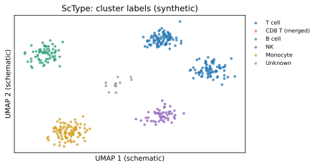<figcaption>ScType annotated cells — synthetic illustration.</figcaption></figure>

Best when reliable markers exist but a suitable reference is unavailable. The scores are not probabilities; mixed clusters may hide rare cells. Human and mouse marker sets are available; custom sets support other species.

# SingleR: reference expression similarity

[SingleR Book](https://bioconductor.org/books/release/SingleRBook/) | [celldex](https://bioconductor.org/packages/celldex/)

## Input

| Input | Format | Example |
|---|---|---|
| Query | Genes × cells; raw or log-normalized RNA | `expr` |
| Reference | Genes × labeled reference profiles, typically log-expression | MonacoImmuneData |
| Reference labels | One label per reference profile | `ref$label.main` |

| Gene | Query C1 | T reference | B reference |
|---|---:|---:|---:|
| CD3D | 10 | 100 | 2 |
| CD3E | 8 | 80 | 1 |
| MS4A1 | 2 | 20 | 10 |
| CD79A | 1 | 10 | 8 |

## Principle and steps

```{mermaid}
flowchart LR
 A[Labeled reference] --> B[Select discriminative genes]
 Q[Query cell] --> C[Spearman correlations]
 B --> C --> D[Summarize per reference label] --> E[Fine-tune close labels] --> F[Prune weak calls]
```

SingleR selects informative genes by comparing reference labels. It calculates rank correlations with reference profiles and typically summarizes correlations within a label using the 80th percentile. Fine-tuning repeats comparison using genes that distinguish competing labels; pruning flags ambiguous assignments.

```r
q <- c(10,8,2,1)
cor(q,c(100,80,20,10),method='spearman') # 1
cor(q,c(2,1,10,8),method='spearman') # -0.6
```

<figure style="margin: 1.2em auto; text-align:center">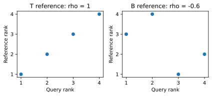<figcaption>Rank correlation example — synthetic illustration.</figcaption></figure>

For example, initial CD4 and CD8 scores of 0.85 and 0.83 can become 0.58 and 0.91 after fine-tuning on discriminatory genes (synthetic scores). The final label can therefore differ from the highest initial score.

## R script

```r
# BiocManager::install(c('SingleR','celldex'))
library(SingleR)
library(celldex)
ref <- MonacoImmuneData()
pred <- SingleR(test=expr,ref=ref,labels=ref$label.main,fine.tune=TRUE)
idx <- match(colnames(pbmc),rownames(pred))
stopifnot(!anyNA(idx))
pbmc$SingleR <- pred$labels[idx]
pbmc$SingleR_pruned <- ifelse(is.na(pred$pruned.labels[idx]),'Unknown',pred$pruned.labels[idx])
head(pred)
head(pred$scores)
plotScoreHeatmap(pred)
plotDeltaDistribution(pred)
DimPlot(pbmc, group.by='SingleR_pruned', label=TRUE)
write.csv(data.frame(cell_id=rownames(pred),labels=pred$labels,
                     delta.next=pred$delta.next,pruned.labels=pred$pruned.labels),
          'singler_labels.csv',row.names=FALSE)
write.csv(pred$scores,'singler_scores.csv')
# Optional cluster-level annotation
pred_cluster <- SingleR(test=expr,ref=ref,labels=ref$label.main,
                        clusters=pbmc$seurat_clusters)
```

## Output: what the annotated cells look like

Native `pred` is a Bioconductor DataFrame; `pred$scores` is a cells × reference labels matrix. Example initial scores (simplified labels):

| Cell | T | B | Monocyte |
|---|---:|---:|---:|
| C1 | 0.91 | 0.21 | 0.13 |
| C3 | 0.15 | 0.89 | 0.20 |
| C5 | 0.19 | 0.25 | 0.92 |

| cell_id | labels | delta.next | pruned.labels |
|---|---|---:|---|
| C1 | CD4 T cells | 0.32 | CD4 T cells |
| C2 | CD8 T cells | 0.24 | CD8 T cells |
| C3 | B cells | 0.54 | B cells |
| C4 | B cells | 0.49 | B cells |
| C5 | Monocytes | 0.55 | Monocytes |
| C6 | Monocytes | 0.51 | Monocytes |
| C7 | CD8 T cells | 0.01 | NA |

<figure style="margin: 1.2em auto; text-align:center">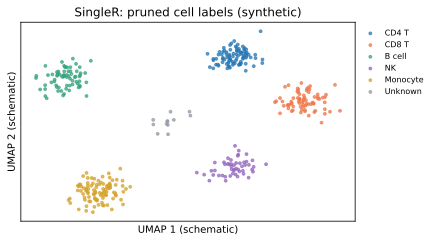<figcaption>SingleR annotated cells — synthetic illustration.</figcaption></figure>

`delta.next` is the separation between best and next-best scores at the last fine-tuning step; pruning also considers a label-specific distribution of delta values. It is not a probability. Other references include HumanPrimaryCellAtlasData, BlueprintEncodeData, DatabaseImmuneCellExpressionData, MouseRNAseqData, ImmGenData and custom references.

# CellTypist: supervised logistic regression

[Documentation](https://celltypist.readthedocs.io/en/latest/) | [Models](https://www.celltypist.org/)

## Input

| Input | Format | Example |
|---|---|---|
| Query | AnnData, cells × genes; log1p counts per 10,000 | `adata.X` |
| Model | Pre-trained classifier with gene features, scaler, coefficients and intercepts | Immune_All_Low.pkl |
| Optional over-clustering | One group per cell | Used for majority voting |

## Principle and steps

```{mermaid}
flowchart TD
 A[Labeled training cells] --> B[Train one-vs-rest logistic regression]
 B --> C[Store coefficients and scaling parameters]
 Q[Query log-normalized expression] --> D[Align genes and standardize]
 C --> E[Decision scores]
 D --> E --> F[Sigmoid scores and best label] --> G[Optional majority voting]
```

CellTypist learns gene coefficients using logistic regression optimized by stochastic gradient descent. A synthetic coefficient matrix is:

| Gene | T | B | Monocyte |
|---|---:|---:|---:|
| CD3D | 1.8 | -0.6 | -0.5 |
| MS4A1 | -0.8 | 2.0 | -0.7 |
| LYZ | -0.4 | -0.3 | 1.8 |
| Intercept | -0.5 | -0.3 | -0.4 |

For standardized expression $(2,-0.5,-1)$, calculate $s_t=b_t+\sum_g w_{tg}x_g$ and $p_t=1/(1+e^{-s_t})$. T cell score = 3.9, sigmoid = 0.980; B score = -2.2, sigmoid = 0.100; monocyte score = -2.85, sigmoid = 0.055. Independent sigmoid scores need not sum to one.

<figure style="margin: 1.2em auto; text-align:center">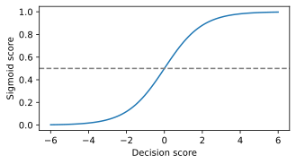<figcaption>Sigmoid decision function — synthetic illustration.</figcaption></figure>

Majority voting assigns the dominant predicted label within an over-cluster (subject to the configured minimum proportion). This can reduce noise but may erase genuine rare populations.

<figure style="margin: 1.2em auto; text-align:center">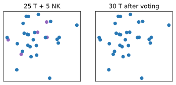<figcaption>Majority voting — synthetic illustration.</figcaption></figure>

## Python script

```bash
pip install celltypist scanpy leidenalg
```

```python
import scanpy as sc
import celltypist
from celltypist import models
adata = sc.datasets.pbmc3k()
adata.var['mt'] = adata.var_names.str.startswith('MT-')
sc.pp.calculate_qc_metrics(adata,qc_vars=['mt'],percent_top=None,inplace=True)
adata = adata[(adata.obs.n_genes_by_counts>200)&
              (adata.obs.n_genes_by_counts<2500)&(adata.obs.pct_counts_mt<5)].copy()
adata.layers['counts'] = adata.X.copy()
sc.pp.normalize_total(adata,target_sum=1e4)
sc.pp.log1p(adata)
models.download_models(model='Immune_All_Low.pkl')
predictions = celltypist.annotate(adata,model='Immune_All_Low.pkl',majority_voting=True)
adata = predictions.to_adata()
print(adata.obs[['predicted_labels','over_clustering','majority_voting','conf_score']].head())
predictions.predicted_labels.to_csv('celltypist_labels.csv')
predictions.decision_matrix.to_csv('celltypist_decision_scores.csv')
predictions.probability_matrix.to_csv('celltypist_probabilities.csv')
sc.pp.highly_variable_genes(adata)
sc.tl.pca(adata)
sc.pp.neighbors(adata,n_pcs=20)
sc.tl.umap(adata)
sc.pl.umap(adata,color=['predicted_labels','majority_voting','conf_score'])
models.models_description()
```

## Output: what the annotated cells look like

`predictions.predicted_labels`, `decision_matrix`, and `probability_matrix` are pandas DataFrames; the latter two have cells × model labels. `to_adata()` adds metadata to `adata.obs`. Illustrative labels are shortened for readability.

| cell_id | predicted_labels | over_clustering | majority_voting | conf_score |
|---|---|---|---|---:|
| C1 | CD4 T | 0 | CD4 T | 0.96 |
| C2 | CD8 T | 1 | CD8 T | 0.94 |
| C3 | B cell | 2 | B cell | 0.98 |
| C4 | B cell | 2 | B cell | 0.97 |
| C5 | Monocyte | 3 | Monocyte | 0.99 |
| C6 | Monocyte | 3 | Monocyte | 0.95 |
| C7 | NK | 1 | CD8 T | 0.40 |

| cell_id | T sigmoid | B sigmoid | Monocyte sigmoid |
|---|---:|---:|---:|
| C1 | 0.980 | 0.100 | 0.055 |
| C3 | 0.04 | 0.98 | 0.02 |
| C5 | 0.03 | 0.05 | 0.99 |

<figure style="margin: 1.2em auto; text-align:center">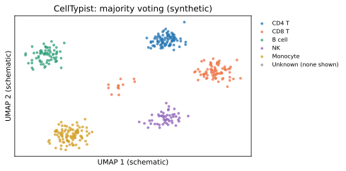<figcaption>CellTypist annotated cells — synthetic illustration.</figcaption></figure>

`conf_score` depends on the selected label and `to_adata` options; it is not a universally calibrated probability. Immune_All_High uses broader categories; Immune_All_Low uses finer categories. Tissue-specific and custom models are available.

# Classical Azimuth: anchor-based reference mapping

[Azimuth](https://satijalab.org/azimuth/) | [Seurat reference mapping](https://satijalab.org/seurat/articles/multimodal_reference_mapping)

## Input

| Input | Format | Example |
|---|---|---|
| Query | Raw RNA counts, genes × cells (Seurat or supported file) | `pbmc` |
| Reference atlas | Annotated expression, reductions, neighbor structures and UMAP model | `pbmcref` |
| Reference labels | Hierarchical cell identities | celltype.l1, celltype.l2 |

## Principle and steps

```{mermaid}
flowchart LR
 A[Query counts] --> B[Normalize and project]
 R[Reference atlas] --> B --> C[Find and score anchors] --> D[Weighted label transfer] --> E[Reference UMAP projection]
```

Reference PCA or supervised PCA defines the coordinate system. In a simplified example the gene loadings for PC1 are $(0.707,-0.707,0)$ and PC2 $(0,0,1)$. For standardized query $(2,-1,-0.5)$ the projected coordinates are $(2.121,-0.5)$. The method finds corresponding reference-query cell pairs (anchors), evaluates their quality and transfers labels using weighted anchor contributions.

<figure style="margin: 1.2em auto; text-align:center">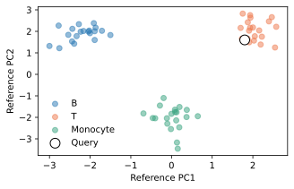<figcaption>Reference mapping — synthetic illustration.</figcaption></figure>

$$P_t=\sum_i w_i I(l_i=t).$$

| Anchor | Label | Weight |
|---|---|---:|
| A1 | CD8 T | 0.35 |
| A2 | CD8 T | 0.25 |
| A3 | CD8 T | 0.20 |
| A4 | CD4 T | 0.12 |
| A5 | NK | 0.08 |

CD8 T receives 0.80 total support, CD4 T 0.12 and NK 0.08. The full algorithm is more complex than simple nearest-neighbor voting.

## R script

```r
# remotes::install_github('satijalab/azimuth')
# remotes::install_github('satijalab/seurat-data')
library(Azimuth)
library(SeuratData)
InstallData('pbmcref')
pbmc_az <- RunAzimuth(query=pbmc,reference='pbmcref')
head(pbmc_az[[]])
DimPlot(pbmc_az,reduction='ref.umap',group.by='predicted.celltype.l1',label=TRUE)
DimPlot(pbmc_az,reduction='ref.umap',group.by='predicted.celltype.l2',label=TRUE)
FeaturePlot(pbmc_az,reduction='ref.umap',features='predicted.celltype.l2.score')
write.csv(pbmc_az[[]],'azimuth_metadata.csv')
write.csv(Embeddings(pbmc_az,'ref.umap'),'azimuth_reference_umap.csv')
```

### Custom reference mapping with Seurat

```r
ref <- readRDS('annotated_reference.rds') # ref$cell_type contains known labels
ref <- NormalizeData(ref)
ref <- FindVariableFeatures(ref)
ref <- ScaleData(ref)
ref <- RunPCA(ref,npcs=30)
ref <- RunUMAP(ref,dims=1:30,return.model=TRUE)
query <- NormalizeData(pbmc)
anchors <- FindTransferAnchors(reference=ref,query=query,
  reference.reduction='pca',normalization.method='LogNormalize',dims=1:30)
query <- MapQuery(anchorset=anchors,query=query,reference=ref,
  refdata=list(cell_type='cell_type'),reference.reduction='pca',reduction.model='umap')
DimPlot(query,reduction='ref.umap',group.by='predicted.cell_type',label=TRUE)
```

`MapQuery` wraps `TransferData`, `IntegrateEmbeddings`, and `ProjectUMAP`.

## Output: what the annotated cells look like

The returned Seurat object contains annotation metadata and reference embeddings. Exact column names depend on the atlas.

| cell_id | predicted.celltype.l1 | predicted.celltype.l2 | predicted.celltype.l2.score |
|---|---|---|---:|
| C1 | CD4 T | CD4 Naive | 0.92 |
| C2 | CD8 T | CD8 TEM | 0.87 |
| C3 | B | B naive | 0.95 |
| C4 | B | B memory | 0.91 |
| C5 | Mono | CD14 Mono | 0.98 |
| C6 | Mono | CD16 Mono | 0.89 |
| C7 | CD8 T | CD8 TEM | 0.42 |

`Embeddings(pbmc_az,'ref.umap')` example:

| cell_id | UMAP_1 | UMAP_2 |
|---|---:|---:|
| C1 | 3.1 | 4.2 |
| C2 | 4.5 | 2.1 |
| C3 | -3.4 | 3.0 |
| C5 | 0.1 | -4.2 |

<figure style="margin: 1.2em auto; text-align:center">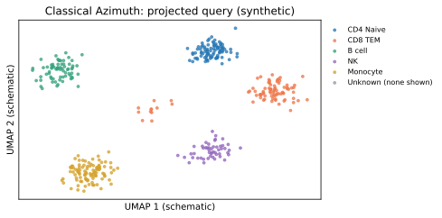<figcaption>Classical Azimuth annotated cells in schematic reference UMAP — synthetic illustration.</figcaption></figure>

Useful for consistent reference coordinates and hierarchical labels across cohorts. High mapping scores are not proof of biological correctness for out-of-reference cells.

# Pan-human Azimuth: neural network classifier

[Official documentation](https://satijalab.org/pan_human_azimuth/) | [R tutorial](https://satijalab.org/seurat/articles/intro_azimuthapi_vignette)

## Input

| Input | Format | Example |
|---|---|---|
| Query | Human RNA expression; log-normalized for illustrated R workflow | Seurat object |
| Model | Pre-trained hierarchical neural network and gene features | Pan-human model |
| Taxonomy | Built-in human cell label hierarchy | Broad, medium, fine |

## Principle and steps

```{mermaid}
flowchart LR
 A[Human expression] --> B[Match model genes] --> C[Neural network] --> D[Hierarchical label predictions] --> E[Confidence and embedding]
```

Unlike classical Azimuth, Pan-human Azimuth performs neural network inference rather than anchor-based mapping. Hidden layers learn nonlinear transformations $h=f(Wx+b)$; hierarchical classification organizes labels at different resolutions. For example, a cell may be identified broadly as a T cell and more finely as a CD8 effector T cell. The model supports multiple human tissues; the current model taxonomy and preprocessing are documented on the official site.

<figure style="margin: 1.2em auto; text-align:center">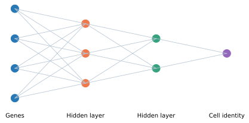<figcaption>Conceptual neural network and hierarchy — synthetic illustration.</figcaption></figure>

## R script

```r
# remotes::install_github('satijalab/AzimuthAPI')
library(AzimuthAPI)
pbmc <- NormalizeData(pbmc)
# Cloud option: requires authorization to transfer expression data externally
# pbmc_pan <- CloudAzimuth(pbmc)
# Local option: install panhumanpy in a compatible Python environment first
library(reticulate)
use_condaenv('pan-human-azimuth',required=TRUE)
pbmc_pan <- ANNotate(pbmc)
head(pbmc_pan[[]])
DimPlot(pbmc_pan,group.by='azimuth_medium',label=TRUE)
DimPlot(pbmc_pan,group.by='azimuth_fine',label=TRUE)
FeaturePlot(pbmc_pan,features='final_level_confidence')
# Use returned embedding dimensions rather than hard-coding the size
pbmc_pan <- RunUMAP(pbmc_pan,reduction='azimuth_embed',
  dims=seq_len(ncol(Embeddings(pbmc_pan,'azimuth_embed'))),
  reduction.name='azimuth_umap')
DimPlot(pbmc_pan,reduction='azimuth_umap',group.by='azimuth_fine',label=TRUE)
write.csv(pbmc_pan[[]],'panhuman_labels.csv')
```

```bash
conda create -n pan-human-azimuth python=3.9
conda activate pan-human-azimuth
pip install panhumanpy
```

Consult the official installation instructions for supported Python versions and GPU options. For sensitive patient data, local execution is preferable if institutional policy prohibits external data transfer.

## Output: what the annotated cells look like

The annotated object contains hierarchical metadata, final-level confidence and model embeddings. Example labels below are schematic and not exact taxonomy strings.

| cell_id | azimuth_broad | azimuth_medium | azimuth_fine | final_level_confidence |
|---|---|---|---|---:|
| C1 | Immune | T cell | CD4 naive T | 0.94 |
| C2 | Immune | T cell | CD8 effector T | 0.92 |
| C3 | Immune | B cell | Naive B | 0.97 |
| C4 | Immune | B cell | Memory B | 0.91 |
| C5 | Immune | Myeloid | Classical monocyte | 0.98 |
| C6 | Immune | Myeloid | Nonclassical monocyte | 0.89 |
| C7 | Immune | T cell | CD8 T | 0.43 |

The full hierarchy and final-level label can also be available as `full_hierarchical_labels` and `final_level_labels`. Embedding output is cells × learned latent features (documented model provides 128 dimensions); this is not a classical reference UMAP.

<figure style="margin: 1.2em auto; text-align:center"><figcaption>Pan-human Azimuth annotated cells — synthetic illustration.</figcaption></figure>

# scANVI: semi-supervised generative deep learning

[scvi-tools documentation](https://docs.scvi-tools.org/en/latest/tutorials/)

## Input

| Input | Format | Example |
|---|---|---|
| Reference and query | Cells × genes raw UMI counts in AnnData | `adata.layers['counts']` |
| Known labels | Reference cells labeled; query marked Unknown | `annotation` |
| Batch covariates | Per-cell sample or technical batch ID | `dataset` (teaching example) |

## Principle and steps

```{mermaid}
flowchart TD
 A[Reference counts and labels] --> C[Joint raw count matrix]
 B[Unlabeled query counts] --> C --> D[Train scVI VAE] --> E[Train semi-supervised scANVI]
 E --> F[Latent embedding]
 E --> G[Predicted labels and probabilities]
```

scANVI extends scVI's variational autoencoder to use known labels during training and infer labels for unlabeled cells. It models count distributions and specified batch covariates, learns a nonlinear latent representation, and predicts cell types. It is useful when annotation and joint representation learning are both required. A 20,000-gene count profile may be represented by 30 latent dimensions. Batch correction cannot reliably separate biological effects from perfectly confounded technical covariates.

<figure style="margin: 1.2em auto; text-align:center">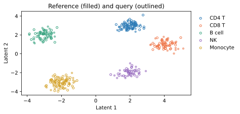<figcaption>Shared latent space — synthetic illustration.</figcaption></figure>

## Python script

```bash
pip install scvi-tools scanpy scikit-misc
```

```python
import scanpy as sc
import scvi
import anndata as ad
ref = sc.read_h5ad('pbmc_reference.h5ad') # requires annotated reference and raw counts layer
query = sc.datasets.pbmc3k()
ref.X = ref.layers['counts'].copy()
ref.obs['annotation'] = ref.obs['cell_type'].astype(str)
query.obs['annotation'] = 'Unknown'
ref.obs['dataset'] = 'reference'
query.obs['dataset'] = 'query'
adata = ad.concat([ref,query],join='inner',index_unique='-')
adata.layers['counts'] = adata.X.copy()
sc.pp.highly_variable_genes(adata,layer='counts',flavor='seurat_v3',
                           n_top_genes=3000,batch_key='dataset',subset=True)
scvi.model.SCVI.setup_anndata(adata,layer='counts',batch_key='dataset')
vae = scvi.model.SCVI(adata,n_layers=2,n_latent=30)
vae.train()
model = scvi.model.SCANVI.from_scvi_model(vae,labels_key='annotation',
                                         unlabeled_category='Unknown')
model.train(max_epochs=20)
adata.obs['scANVI'] = model.predict()
prob = model.predict(soft=True)
adata.obs['scANVI_score'] = prob.max(axis=1)
adata.obsm['X_scANVI'] = model.get_latent_representation()
sc.pp.neighbors(adata,use_rep='X_scANVI')
sc.tl.umap(adata)
sc.pl.umap(adata,color=['dataset','annotation','scANVI','scANVI_score'])
query_annotated = adata[adata.obs['dataset']=='query'].copy()
query_annotated.write_h5ad('query_annotated_scanvi.h5ad')
prob.loc[query_annotated.obs_names].to_csv('scanvi_probabilities.csv')
query_annotated.obs.to_csv('scanvi_metadata.csv')
```

Perform dataset-specific QC on both inputs before joint training in a production workflow. The reference file is user-supplied; it is not bundled. scArches-style mapping can reuse a pretrained reference rather than jointly retraining.

## Output: what the annotated cells look like

| cell_id | dataset | annotation (input) | scANVI | scANVI_score |
|---|---|---|---|---:|
| R1 | reference | CD4 T | CD4 T | 0.98 |
| C1 | query | Unknown | CD4 T | 0.95 |
| C2 | query | Unknown | CD8 T | 0.96 |
| C3 | query | Unknown | B cell | 0.98 |
| C4 | query | Unknown | B cell | 0.95 |
| C5 | query | Unknown | Monocyte | 0.99 |
| C6 | query | Unknown | Monocyte | 0.94 |
| C7 | query | Unknown | CD8 T | 0.44 |

`model.predict(soft=True)` yields a cells × labels matrix, e.g.:

| cell_id | CD4 T | CD8 T | B | Monocyte |
|---|---:|---:|---:|---:|
| C1 | 0.95 | 0.03 | 0.01 | 0.01 |
| C2 | 0.02 | 0.96 | 0.01 | 0.01 |
| C7 | 0.40 | 0.44 | 0.06 | 0.10 |

`adata.obsm['X_scANVI']` stores a cells × 30 latent matrix in this example.

<figure style="margin: 1.2em auto; text-align:center">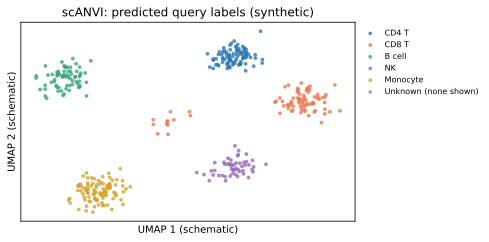<figcaption>scANVI annotated cells — synthetic illustration.</figcaption></figure>

Unknown is a training designation, not necessarily a predicted novel class. A high model probability does not guarantee correct identity.

# Comparison of methods

| Feature | ScType | SingleR | CellTypist | Classical Azimuth | Pan-human Azimuth | scANVI |
|---|---|---|---|---|---|---|
| Algorithm | Weighted marker score | Rank correlation | Logistic regression | Anchor mapping | Neural classifier | Semi-supervised VAE |
| Language | R | R | Python | R | R/Python | Python |
| Knowledge source | Marker sets | Reference profiles | Trained coefficients | Reference atlas | Trained model | Partially labeled counts/model |
| Query input | Log-normalized or scaled RNA | Raw/log RNA | Log1p CP10K | Raw RNA | Log-normalized (R workflow) | Raw UMI counts |
| Annotation unit | Usually cluster | Cell or cluster | Cell | Cell | Cell | Cell |
| Clustering needed | Standard workflow | Optional | Optional voting | No | No | No |
| PCA needed | No | No | No | Reference reduction | No | No |
| Reference at inference | No | Yes or trained reference object | Model only | Yes | Model only | Workflow-dependent |
| Human | Yes | Yes | Yes | Yes | Yes | Yes |
| Mouse | Yes | Yes | Model-dependent | Reference-dependent | No | Custom training |
| Other species | Custom markers | Custom reference | Custom training | Custom reference | No | Custom training |
| Score | Marker score | Correlation/delta | Sigmoid/decision | Anchor support | Model confidence | Class probability |
| Embedding output | No | No | No | Reference UMAP | Neural embedding | Latent space |
| Batch-aware integration | No | No | No | Reference alignment | Not explicit | Yes |
| Training cost | None | Reference preprocessing | Pretrained or custom | Reference building | Pretrained | Higher; GPU useful |
| Typical limitation | Marker/cluster quality | Reference coverage | Training bias | Reference mismatch | Human taxonomy coverage | Training data and resources |

## What does an annotation output actually contain?

All methods can be reduced to a common cell metadata table, although their native results differ. Preserve native scores and labels alongside harmonized broad labels; do not compare numerical scores across methods as if they were calibrated on the same scale.

| Cell | ScType | SingleR | CellTypist | Classical Azimuth | Pan-human Azimuth | scANVI |
|---|---|---|---|---|---|---|
| C1 | T | CD4 T | CD4 T | CD4 Naive | CD4 naive T | CD4 T |
| C2 | T | CD8 T | CD8 T | CD8 TEM | CD8 effector T | CD8 T |
| C3 | B | B | B | B naive | Naive B | B |
| C5 | Monocyte | Monocyte | Monocyte | CD14 Mono | Classical monocyte | Monocyte |
| C7 | Unknown | NA | CD8 T (voted) | CD8 TEM | CD8 T | CD8 T |

# Multi-sample workflow and validation

```{mermaid}
flowchart TD
 A[Per-library QC and doublet detection] --> B[Merge; keep sample IDs]
 B --> C[Exploration: integration, PCA, clustering, UMAP]
 B --> D[Annotation: gene expression and consistent model]
 C --> E[Marker/cluster annotation]
 D & E --> F[Validate markers, confidence and disagreements]
 F --> G[Harmonized final labels]
 G --> H[Per-donor proportions and pseudobulk DE]
```

| Step | Data level | Input |
|---|---|---|
| QC and doublets | Per library | Raw counts |
| Integration/clustering | Combined | Normalized data or raw counts depending on method; embeddings |
| ScType | Usually combined | Expression + clusters |
| SingleR, CellTypist, classical/Pan-human Azimuth | Either | Consistent gene expression and reference/model |
| scANVI | Usually combined or reference mapping | Raw counts and covariates |
| Validation | Combined and per sample | Original RNA expression and labels |
| Composition and DE | Per donor/cell type | Counts, labels, sample IDs |

## Validate marker expression

```r
markers <- c('CD3D','CD3E','TRAC','CD4','IL7R','CD8A','CD8B','NKG7','GNLY',
             'MS4A1','CD79A','LYZ','S100A8','LST1','FCGR3A','PPBP','PF4')
DotPlot(pbmc,features=intersect(markers,rownames(pbmc)),group.by='SingleR_pruned') + RotatedAxis()
```

<figure style="margin: 1.2em auto; text-align:center">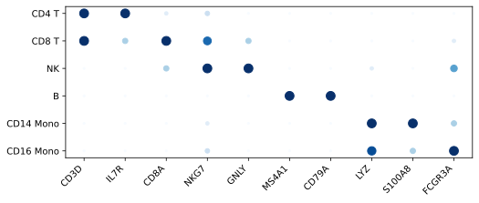<figcaption>Illustrative marker dot plot — synthetic illustration.</figcaption></figure>

For a disputed cytotoxic cluster, CD3D/CD3E/TRAC and CD8A/CD8B support T-lineage, while NKG7/GNLY/GZMB describe cytotoxic function shared with NK cells. Investigate possible doublets and mixed clusters. Avoid forcing novel disease states into healthy reference labels.

## Import labels and compare methods

```r
# Example: match exported Python labels by unique cell ID
ct <- read.csv('celltypist_labels.csv',row.names=1,check.names=FALSE)
# Only after verifying barcode conventions match across workflows
idx <- match(colnames(pbmc),rownames(ct))
pbmc$CellTypist <- ct$majority_voting[idx]
pbmc$Azimuth <- pbmc_az$predicted.celltype.l2[match(colnames(pbmc),colnames(pbmc_az))]
library(patchwork)
(DimPlot(pbmc,group.by='ScType') | DimPlot(pbmc,group.by='SingleR_pruned')) /
(DimPlot(pbmc,group.by='CellTypist') | DimPlot(pbmc,group.by='Azimuth'))
# After explicitly harmonizing label vocabularies into *_broad columns:
# tab <- table(pbmc$CellTypist_broad,pbmc$Azimuth_broad)
# pheatmap::pheatmap(prop.table(tab,1),display_numbers=TRUE)
```

<figure style="margin: 1.2em auto; text-align:center">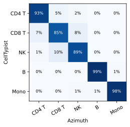<figcaption>Illustrative agreement matrix — synthetic illustration.</figcaption></figure>

Agreement is not ground truth. Shared reference biases can generate similar mistakes. Keep Unknown labels where evidence is insufficient.

# Method selection

| Scenario | Suggested approach |
|---|---|
| Human PBMC | CellTypist or classical Azimuth; marker validation |
| Human multi-tissue | Pan-human Azimuth with tissue-aware validation |
| Mouse immune | SingleR with ImmGen, ScType |
| Non-model organism | Custom marker sets or species-matched reference |
| Custom reference | SingleR or Seurat label transfer |
| Large multi-batch study | scANVI when integration is needed; pretrained classifiers for rapid annotation |
| Novel disease populations | Exploratory clustering, markers and conservative annotation |

# Spatial transcriptomics extension

| Spatial observation | Suggested approach |
|---|---|
| Xenium segmented cell | Marker-based or reference classifier if gene panel supports it |
| Visium HD segmented cell | Reference classifier/marker annotation; validate segmentation |
| 2 µm bin | Aggregate or segment; individual bins may be sparse |
| 8 µm bin | Annotation or deconvolution depending on mixing and coverage |
| 16 µm bin or conventional Visium spot | Consider RCTD or Cell2location for mixed-cell observations |

Annotation assigns a label to an observation; deconvolution estimates contributions from multiple cell types. The physical bin size alone does not guarantee a single cell.

# Key takeaways

ScType asks which markers are expressed; SingleR asks which reference profile is most similar; CellTypist applies learned linear coefficients; classical Azimuth transfers labels using a reference atlas; Pan-human Azimuth uses a hierarchical neural classifier; scANVI jointly learns a probabilistic latent representation and labels. Choose the method based on biological context, reference coverage, input format and downstream objectives rather than confidence scores alone.

# Resources

- [ScType source](https://github.com/IanevskiAleksandr/sc-type)
- [SingleR diagnostics](https://bioconductor.org/books/release/SingleRBook/annotation-diagnostics.html)
- [CellTypist tutorial](https://celltypist.readthedocs.io/en/latest/notebook/celltypist_tutorial.html)
- [Seurat reference mapping](https://satijalab.org/seurat/articles/multimodal_reference_mapping)
- [Pan-human Azimuth](https://satijalab.org/pan_human_azimuth/)
- [scvi-tools](https://docs.scvi-tools.org/en/latest/)

