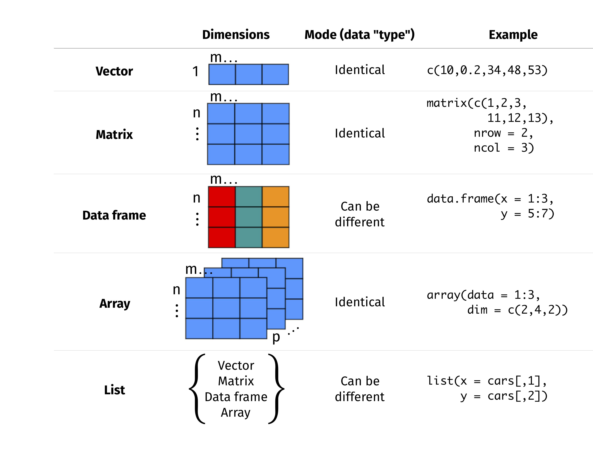

## Data Structure

{width=600px}

## General Functions

In R, "\n" is a newline, "\t" is a tab, and "\\" means a single backslash.

```r
if (!requireNamespace("BiocManager", quietly = TRUE))
    install.packages("BiocManager")

BiocManager::install(c("xml2", "stringi", "stringr", "lintr", "roxygen2", "languageserver"))

BiocManager::install(c("LiblineaR", "caret", "drc", "e1071", "ROCR", "pROC", "rhdf5", "randomForest", "VSURF"))


BiocManager::install(c(
    "languageserver", "httpgd", "rmarkdown", "IRkernel", "jsonlite", "rlang",
      "ComplexHeatmap", "caret", "clusterProfiler", "DESeq2", "dendsort",
      "doParallel", "e1071", "enrichplot", "fs", "ggbeeswarm", "ggpmisc",
      "ggpubr", "ggrastr", "ggrepel", "ggupset", "glmnet", "here", "ijtiff",
       "MetaboCoreUtils", "MsCoreUtils", "org.Hs.eg.db", "parallel",
    "png", "pROC", "RColorBrewer", "RImageJROI", "readxl", "ropls", "rstatix","Seurat", "tidyverse"
   ), update = FALSE, ask = FALSE, force = TRUE)

remotes::install_github("ManuelHentschel/vscDebugger")
```


```r
find.package("ggplot2")
find.package("Seurat")
```

```r
.libPaths()                      # Show library paths
dir()                            # Show the directory
getwd()                          # Check working directory
setwd()                          # Change working directory
data()                           # Load built-in dataset
view()                           # View the entire dataset
tail()                           # Just show the last 6 rows
class()                          # Check the class of an R object
str()                            # Display internal structure of an R object
length()                         # Give length of a vector
dim()                            # View the number of rows and columns of a matrix or a data frame
names()                          # List names of variables in a data frame
set.seed()                       # Generate random number seed to make sure the results do not change.
ls()                             # list the variables in the workspace
rm()                             # remove the variable from workspace
rm(list = ls())                  # remove all the variables from the workspace
list.files()                     # List the filename under specific directory
.libPaths()                      # R installation site
help(package="")                 # Check the functions of R library
system.file(package=“dagdata”)   # Extract the location of package
colnames(installed.packages())   # list the installed packages
```

## Coding Practice

- Variables = my_variable or myVariable
- Functions = RunThisStuffs() or run_this_stuffs()
- A function should not be longer than one screen
- Constants = CONSTANTS
- Use 4 spaces (and not tab) for indentations
- Always writing documentation above function definition
- Avoid using for loop, learn lapply and vector operations
- Never ever use hard-coded variables in functions
- `### ======` to divide function blocks
- `### ------` to divide parts in a function
- Name and style code consistently
- `rm(list =ls())` and `gc()` to tidy up its memory
- Don't save a session history
- Keep track of `sessionInfo()` in project folder
- Use version control

## Variable Replacement

Common method to do the variable replacement in ggplot2:

- `!!as.name()`
- `get()`
- `!!sym()`
- `.data[[]]`

```{r}
#| eval: false
library(ggplot2)
data <- data.frame(
    x = c(1, 2, 3, 4),
    y = c(10, 20, 30, 40),
    group = c("A", "A", "B", "B")
)

color_var <- "group"
ggplot(data, aes(x = x, y = y, color = !!as.name(color_var))) +
    geom_point()

ggplot(data, aes(x = x, y = y, color = get(color_var))) +
    geom_point()


ggplot(data, aes(x = x, y = y, color = !!sym(color_var))) +
    geom_point()

ggplot(data, aes(x = x, y = y, color = .data[[color_var]])) +
    geom_point()
```

## Text size

| Base R (`cex`) | ggplot2 (`size`) | Description |
| --- | --- | --- |
| 0.5 | 6 | Very small |
| 0.6 | 7.2 | Small (your current) |
| 0.7 | 8.4 | Small-medium |
| 0.8 | 9.6 | Medium |
| 0.9 | 10.8 | Medium-large |
| 1.0 | 12 | Default/normal |
| 1.2 | 14.4 | Large |
| 1.5 | 18 | Very large |

## VSCode Setup

**Remote Server Settings:**
```json
{
    "r.alwaysUseActiveTerminal": true,
    "r.bracketedPaste": true,
    "r.helpPanel.cacheIndexFiles": "Global",
    "r.plot.useHttpgd": true,
    "r.rmarkdown.chunkBackgroundColor": "",
    "r.rterm.option": [
        // "--r-binary=/home/zhonggr/miniforge3/envs/renv/bin/R",
        "--no-save",
        "--no-restore"
    ],
    "r.rpath.linux": "/home/zhonggr/miniforge3/envs/renv/bin/R",
    "r.rterm.linux": "/home/zhonggr/miniforge3/envs/renv/bin/radian"
}
```

```json
{
    "r.bracketedPaste": true,
    "r.alwaysUseActiveTerminal": true,
    "r.plot.useHttpgd": true,
    "r.rterm.linux": "${userHome}/miniforge3/envs/renv/bin/radian",
    "r.rpath.linux": "${userHome}/miniforge3/envs/renv/bin/R",
    "r.rterm.mac": "${userHome}/miniforge3/envs/renv/bin/radian",
    "r.rpath.mac": "${userHome}/miniforge3/envs/renv/bin/R",
    "r.rterm.option": [
        "--no-save", // Optional: Prevent saving workspace
        "--no-restore", // Optional: Prevent restore workspace
        "--no-site-file", // Optional: Avoid loading site-wide R profile
        "--r-binary=${userHome}/miniforge3/envs/renv/bin/R"
    ],
    "r.libPaths": [
        "${userHome}/miniforge3/envs/renv/lib/R/library"
    ],
    "r.plot.useHttpgd": true,
    "[r]": {
        "editor.defaultFormatter": "REditorSupport.r"
    },
    "files.associations": {
        "*.rmd": "rmd"
    },
}
```

## Server settings
```json
{
    "r.alwaysUseActiveTerminal": true,
    "r.bracketedPaste": true,
    // "r.consolePath": "arf",
    "r.consolePath": "/home/guorui/.pixi/envs/radian/bin/radian",
    "r.rpath.linux": "/home/guorui/.pixi/envs/bin/R",
    "r.plot.backend": "httpgd",
    "r.executablePath": "/home/guorui/.pixi/envs/renv/bin/R",
    "shfmt.executablePath": "${userHome}/.pixi/bin/shfmt"
    // 3. Inform Radian where to find R so it hooks into the same background session
}
```

## Reference

- https://r4bds.github.io
- Programming with R
- Best Practice for R - Cheat Sheet
- An Introduction to Statistical Learning
- R for Data Science (2e)
- R Graphics Cookbook, 2nd edition
- Advanced R
- ggplot2: Elegant Graphics for Data Analysis
- Functional Programming
- The Epidemiologist R Handbook
- Modern Statistics for Modern Biology
- Data Analysis and Prediction Algorithms with R
- Bioinformatics Training & Education Program
- Saving R Graphics across OSs
- Tutorial on Advanced Stats and Machine Learning with R
- Publication ready plots using ggpubr
- datanovia
- Data Analysis in Genome Biology
- Data Viz with Python and R
- PH525x series - Biomedical Data Science
- An Introduction to Statistical Learning
- The Epidemiologist R Handbook
- Data Analysis in Genome Biology
- PH525x series - Biomedical Data Science